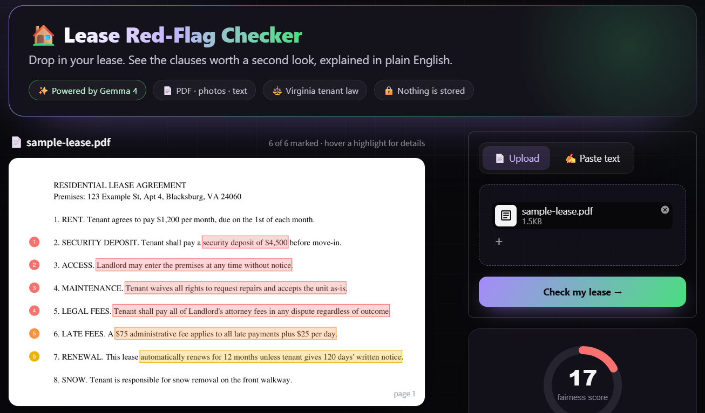
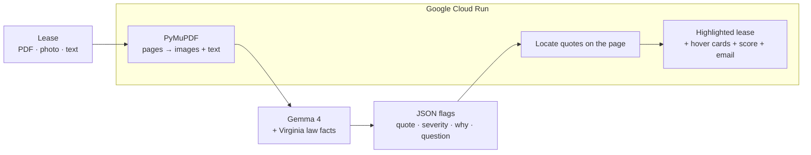

# 🏠 Lease Red-Flag Checker

[](https://github.com/shreyapbodanki/lease-red-flag-checker/actions/workflows/tests.yml)
[](LICENSE)
[](CONTRIBUTING.md)
[](https://ai.google.dev/gemma)

Upload a lease (PDF, photos, or pasted text) and get plain-English flags on clauses that may be unfair to tenants or may conflict with Virginia renter law. Hover any highlight to see why it matters and what to ask your landlord.

Built at **GDG Build with AI × Hacktoberfest 2026** at Virginia Tech (AI for Good: Housing).

**🔗 Live demo:** https://lease-checker-827970078270.us-east1.run.app



> Not legal advice. This tool points out clauses worth a second look; it doesn't replace a lawyer or your local tenant resources.

## Why

Most student renters sign leases without reading every clause, and the ones that matter (huge deposits, entry without notice, waived repairs, one-sided fees) are easy to miss. This tool makes a lease readable in under a minute.

## What it does

- Reads leases as **PDFs, phone photos, or pasted text** (multimodal: PDF pages are sent to Gemma as images)
- Gives the lease a **fairness score** and highlights flagged clauses **directly on the PDF pages** (or in pasted text)
- **Hover any highlight** to see why it matters, what to ask, and the relevant Virginia law
- Flags risky clauses with the **exact quote**, a **severity** (high / medium / low), and a **plain-English explanation**
- Links each flag to the **Virginia Code section** it relates to, plus free legal help (VT Student Legal Services, Virginia Legal Aid, DHCD handbook)
- Drafts a **landlord email** you can copy and edit
- Retries automatically if the API is busy, and falls back to the PDF's text if image analysis fails

## How it works



1. Uploaded PDFs are rendered to images (up to 8 pages) and their text is extracted. Photos and pasted text are passed as-is.
2. Gemma 4 gets the lease plus a prompt with verified facts from the Virginia Residential Landlord and Tenant Act (deposit caps, late fee limits, entry notice, prohibited lease terms).
3. The model returns structured JSON (summary + flags), which the app sorts by severity.
4. Each flagged quote is located on the PDF page with PyMuPDF, boxed in its severity color, and overlaid with a hover card.

Leases are only sent to the model for analysis. The app does not store them.

## Accuracy

The checker is measured against a **labeled test set** of 15 Virginia leases and 87 clauses in [`eval/leases.json`](eval/leases.json). Every clause is labeled:

| Label | Meaning | Count |
|---|---|---|
| `flag` | Conflicts with the Virginia Residential Landlord and Tenant Act (each cites a code section) | 23 |
| `ok` | Ordinary clause that should **not** be flagged | 52 |
| `either` | Legal but unfavorable, or arguable. Reported but **not scored** | 12 |

The set includes plain-English and dense legalese leases, clauses sitting exactly at the legal limits (a deposit of exactly 2 months, a late fee of exactly 10%), and a fully fair lease written in intimidating legal language to test false alarms. Lease titles are never sent to the model.

**Results** (Gemma 4 `gemma-4-26b-a4b-it`, 3 runs per input type, Oct 24 2026):

| Metric | Pasted text | PDF (page images + text) |
|---|---|---|
| **Recall** on clauses that conflict with VA law | **97%** (96–100%) | **97%** (96–100%) |
| **False alarms** on fair clauses | **7%** (6–8%) | **4%** (4–4%) |
| Precision (flags that were real problems) | 86% (85–88%) | 92% (92–92%) |
| Flags with the right category | 81% (77–86%) | 85% (82–87%) |
| Real problems rated high severity | 85% (82–91%) | 81% (77–83%) |
| Flag quotes found in the lease (needed for highlighting) | 97% (94–100%) | 98% (97–100%) |

- The fully fair lease written in dense legalese (L13) got **zero flags in all 6 runs**.
- The one recurring miss is the hardest case: a **$500 pet deposit on top of a $2,000 deposit** (rent $1,000). Pet deposits count toward Virginia's 2-month cap (§ 55.1-1200), so the total is over the limit. The model often noticed the deposit problem but pinned it on the $2,000 clause, which is legal on its own. That's also where one of the false alarms comes from.
- Caveat: this is a small test set written by the project author, so treat these numbers as a sanity check, not a guarantee. More test leases are very welcome (see [Contributing](#contributing)).

Full report: [`eval/results.md`](eval/results.md).

Run it yourself:

```bash
python eval/run_eval.py --mode both --runs 3   # text and PDF input, 3 runs each (needs GEMINI_API_KEY)
python eval/run_eval.py --dry-run              # checks the pipeline with a fake model, no key needed
```

Results are written to [`eval/results.md`](eval/results.md): recall on problem clauses, false alarms on fair clauses, precision, category and severity agreement, how many flag quotes could be located for highlighting, plus a list of every miss and false alarm.

## Built with

- **Gemma 4** (`gemma-4-26b-a4b-it`), an open-weight model, via the Gemini API
- **Streamlit** for the UI
- **PyMuPDF** to turn PDF pages into images and locate quotes for highlighting
- **Docker** + **Google Cloud Run** for hosting (image stored in Artifact Registry)
- **pytest** + **GitHub Actions** for tests on every push

## Run it locally

```bash
pip install -r requirements-dev.txt
```

Get a free API key from [Google AI Studio](https://aistudio.google.com) and set it:

```bash
# mac / linux
export GEMINI_API_KEY="your-key"

# windows powershell
$env:GEMINI_API_KEY="your-key"
```

Then:

```bash
streamlit run app.py
pytest -q              # unit tests, no key needed
```

## Deploy to Google Cloud Run

```bash
docker build -t lease-checker .
docker tag lease-checker us-east1-docker.pkg.dev/PROJECT_ID/lease-repo/lease-checker
docker push us-east1-docker.pkg.dev/PROJECT_ID/lease-repo/lease-checker
gcloud run deploy lease-checker \
  --image us-east1-docker.pkg.dev/PROJECT_ID/lease-repo/lease-checker \
  --region us-east1 --allow-unauthenticated \
  --set-env-vars GEMINI_API_KEY=your-key
```

Cloud Run scales to zero when idle, so the app costs nothing when nobody is using it.

## Project layout

| Path | What it is |
|---|---|
| [`lease_core.py`](lease_core.py) | Prompt, Gemma call, retries, JSON cleanup, PDF rendering, quote matching, scoring |
| [`app.py`](app.py) | Streamlit UI: layout, theme, hover cards |
| [`eval/`](eval) | Labeled test leases and the accuracy script |
| [`tests/`](tests) | Unit tests (run in CI on every push) |

## Contributing

Contributions are welcome, and this repo is Hacktoberfest-friendly. Good places to start:

- **Report a wrong flag:** every missed problem or false alarm can become a new test case
- **Add test leases** to `eval/leases.json`
- **Add another state's** landlord-tenant rules
- Issues labeled [`good first issue`](../../issues?q=is%3Aissue+is%3Aopen+label%3A%22good+first+issue%22)

See [CONTRIBUTING.md](CONTRIBUTING.md) for setup and guidelines, and please follow the [Code of Conduct](CODE_OF_CONDUCT.md).

## Roadmap

- OCR so highlighting also works on scanned leases and phone photos
- Support for other states' landlord-tenant laws
- Ask follow-up questions about your lease in a chat
- Spanish explanations

## License

[MIT](LICENSE)
