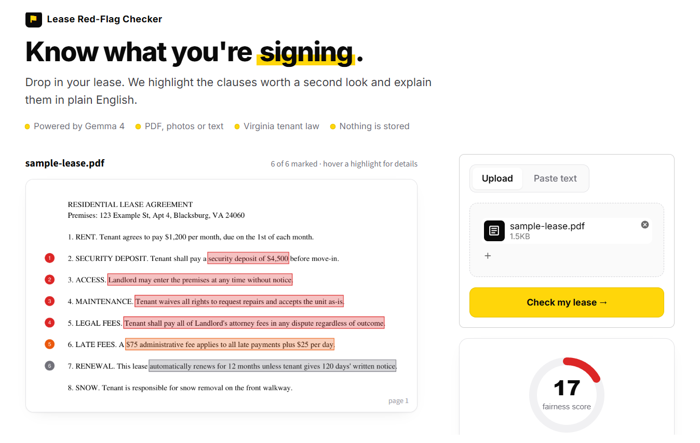
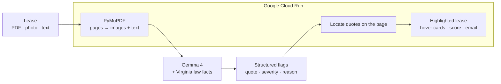

<div align="center">

# Lease Red-Flag Checker

**AI lease review for renters. Upload a lease, see which clauses conflict with Virginia law, and know what to ask before you sign.**

[](https://github.com/shreyapbodanki/lease-red-flag-checker/actions/workflows/tests.yml)
[](LICENSE)
[](https://ai.google.dev/gemma)
[](CONTRIBUTING.md)

[**Live demo**](https://lease-checker-827970078270.us-east1.run.app) · [Accuracy](#accuracy) · [Getting started](#getting-started) · [Contributing](CONTRIBUTING.md)



</div>

---

## Overview

Most renters, especially students signing their first lease, don't read every clause, and the ones that matter are easy to miss: oversized deposits, entry without notice, waived repairs, one-sided legal fees. Lease Red-Flag Checker reads a lease the way a careful friend with a copy of the Virginia Code would, then points to the exact lines worth questioning.

Built at **GDG Build with AI × Hacktoberfest 2026** at Virginia Tech for the **AI for Good: Housing** track.

> **Not legal advice.** This tool highlights clauses worth a second look. It does not replace a lawyer or local tenant resources.

## Features

| | |
|---|---|
| **Multimodal input** | Upload a PDF or phone photos, or paste text. PDF pages are sent to Gemma 4 as images, with extracted text alongside. |
| **Highlights on the real document** | Flagged clauses are boxed directly on the PDF page, color-coded by severity and numbered. |
| **Hover for details** | Hover any highlight to see why it matters, a question to ask the landlord, and the relevant Virginia Code section. |
| **Grounded in law** | The prompt includes verified facts from the Virginia Residential Landlord and Tenant Act, and every flag links to the statute. |
| **Fairness score** | A 0–100 score gives a one-glance verdict before the details. |
| **Next steps** | Generates a ready-to-send email to the landlord and links to free legal help. |
| **Resilient** | Retries when the API is busy and falls back to extracted text if image analysis fails. |
| **Private** | Leases are sent to the model for analysis only. Nothing is stored. |

## Accuracy

The checker is evaluated against a labeled test set of **15 Virginia leases and 87 clauses** ([`eval/leases.json`](eval/leases.json)). Each clause is labeled `flag` (conflicts with Virginia law, with a cited code section), `ok` (should not be flagged), or `either` (legal but unfavorable, reported but not scored).

**Results:** Gemma 4 (`gemma-4-26b-a4b-it`), 3 runs per input type.

| Metric | Pasted text | PDF |
|---|:---:|:---:|
| **Recall** on clauses that conflict with Virginia law | **97%** | **97%** |
| **False-alarm rate** on fair clauses | **7%** | **4%** |
| Precision | 86% | 92% |
| Correct category | 81% | 85% |
| Quotes located for highlighting | 97% | 98% |

**Findings**
- A fully compliant lease written in dense legal language received **zero flags across all six runs**.
- The one recurring miss is a **pet deposit stacked on a maximum security deposit**. Pet deposits count toward Virginia's two-month cap ([§ 55.1-1200](https://law.lis.virginia.gov/vacode/title55.1/chapter12/section55.1-1200/)), but the model tended to attribute the problem to the base deposit clause instead.
- The test set was written by the author, so these results are a sanity check rather than a guarantee. Additional test leases are welcome.

Full report: [`eval/results.md`](eval/results.md)

## How it works



1. **Ingest.** PDFs are rendered to page images (up to 8 pages) and their text is extracted. Photos and pasted text are passed through directly.
2. **Analyze.** Gemma 4 receives the lease along with verified Virginia rules: deposit caps, deposit return deadlines, late fee limits, entry notice, and prohibited lease terms.
3. **Structure.** The model returns JSON with a summary and flags (exact quote, category, severity, explanation, suggested question).
4. **Highlight.** Each quote is located on the page with PyMuPDF, using fuzzy matching when the model rewords it, then boxed and overlaid with a hover card.

## Getting started

**Requirements:** Python 3.12+ and a free API key from [Google AI Studio](https://aistudio.google.com).

```bash
git clone https://github.com/shreyapbodanki/lease-red-flag-checker.git
cd lease-red-flag-checker
pip install -r requirements-dev.txt

export GEMINI_API_KEY="your-key"        # Windows PowerShell: $env:GEMINI_API_KEY="your-key"
streamlit run app.py
```

### Tests

```bash
pytest -q                                      # unit tests, no API key needed
python eval/run_eval.py --mode both --runs 3   # accuracy eval (requires GEMINI_API_KEY)
python eval/run_eval.py --dry-run              # eval pipeline check with a mock model
```

Tests run automatically on every push via GitHub Actions.

### Deploy to Google Cloud Run

```bash
docker build -t lease-checker .
docker tag lease-checker us-east1-docker.pkg.dev/PROJECT_ID/lease-repo/lease-checker
docker push us-east1-docker.pkg.dev/PROJECT_ID/lease-repo/lease-checker
gcloud run deploy lease-checker \
  --image us-east1-docker.pkg.dev/PROJECT_ID/lease-repo/lease-checker \
  --region us-east1 --allow-unauthenticated \
  --set-env-vars GEMINI_API_KEY=your-key
```

Cloud Run scales to zero when idle, so there is no cost when the app isn't in use.

## Project structure

```
├── app.py               Streamlit UI: layout, styling, hover cards
├── lease_core.py        Prompt, Gemma 4 calls, retries, PDF rendering, quote matching, scoring
├── eval/
│   ├── leases.json      Labeled test leases
│   ├── run_eval.py      Accuracy evaluation
│   └── results.md       Latest results
├── tests/               Unit tests (pytest)
├── docs/                Screenshots and contributor backlog
└── Dockerfile           Container for Cloud Run
```

## Tech stack

**Model:** Gemma 4 (open weights) via the Gemini API · **App:** Python, Streamlit · **Documents:** PyMuPDF · **Infrastructure:** Docker, Google Cloud Run, Artifact Registry · **Quality:** pytest, GitHub Actions

## Roadmap

- [ ] OCR so highlighting also works on scanned leases and phone photos
- [ ] Landlord-tenant rules for additional states
- [ ] Follow-up questions about a lease in a chat
- [ ] Spanish explanations

## Contributing

Contributions are welcome, and this repository participates in Hacktoberfest. Good starting points:

- **Report a wrong flag.** Every miss or false alarm can become a new test case.
- **Add test leases** to `eval/leases.json`.
- **Add another state's** landlord-tenant rules.
- Browse issues labeled [`good first issue`](../../issues?q=is%3Aissue+is%3Aopen+label%3A%22good+first+issue%22).

See [CONTRIBUTING.md](CONTRIBUTING.md) for setup and guidelines, and the [Code of Conduct](CODE_OF_CONDUCT.md).

## Acknowledgments

- Legal references from the [Code of Virginia, Title 55.1, Chapter 12](https://law.lis.virginia.gov/vacode/title55.1/chapter12/) (Virginia Residential Landlord and Tenant Act)
- Tenant resources: [VT Student Legal Services](https://legal.uss.vt.edu/), [Virginia Legal Aid](https://www.valegalaid.org/), [DHCD Landlord-Tenant Resources](https://dhcd.virginia.gov/landlord-tenant-resources)
- Built at GDG on Campus Virginia Tech's Build with AI × Hacktoberfest 2026

## License

Released under the [MIT License](LICENSE).
